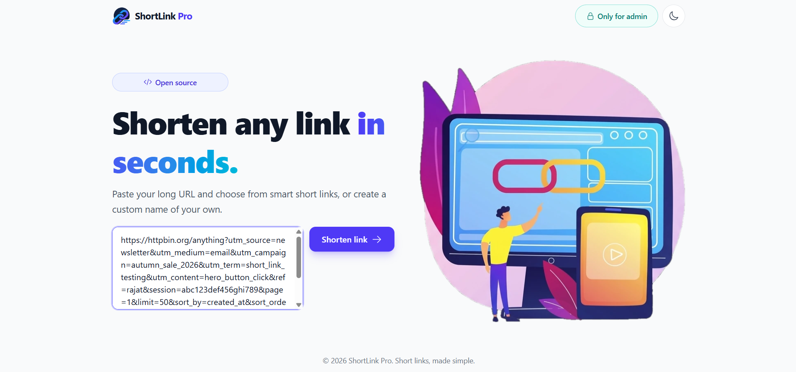
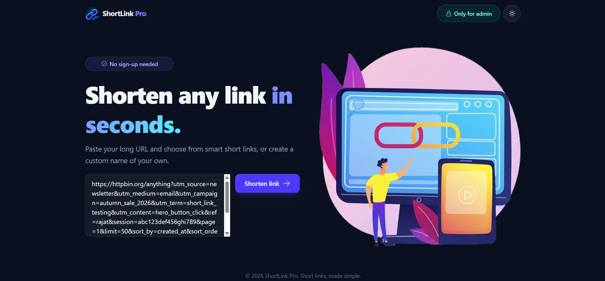
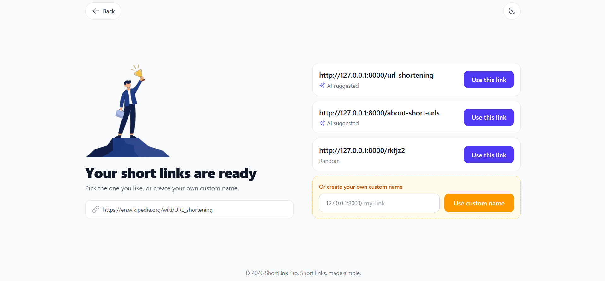
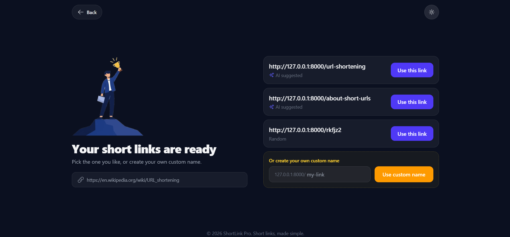
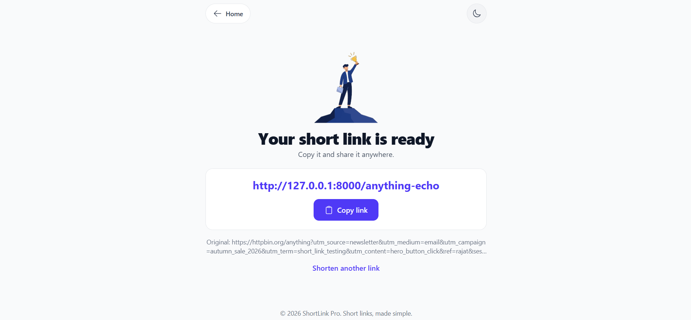
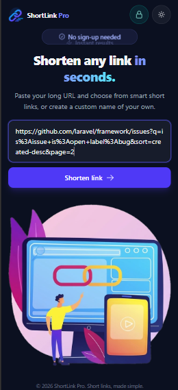
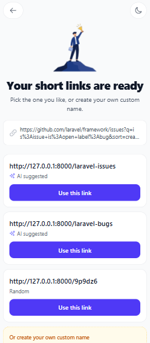

# ShortLink Pro

A free, fast and open-source link shortener. Paste a long URL, pick a short link
(two AI-suggested names and a random one), or create your own custom name.



## Features

- **Smart short links:** two readable names suggested by Google Gemini, plus a random code.
  If the AI is unavailable, the app falls back to random, readable and word-based names.
- **Custom names:** choose your own link name with validation.
- **Filtering:** only public `http`/`https` links are accepted (no localhost or private IPs),
  and generated or custom names are checked against reserved and blocked words.
- **Smooth flow:** a loading screen, then a result page that reveals step by step.
- **Click tracking:** every redirect is logged (device, browser, referrer, hashed IP).
- **Light and dark mode** with a mobile-first, responsive layout.
- **Works without AI:** the Gemini key is optional.

## Screenshots

| Light | Dark |
|---|---|
|  |  |
|  |  |

| Final page | Mobile | Mobile |
|---|---|---|
|  |  |  |

## Tech stack

- Laravel 12 (PHP 8.2+)
- MySQL
- Blade, Tailwind CSS v4, Alpine.js, Heroicons
- Google Gemini API (optional, for name suggestions)

## Getting started

Requirements: PHP 8.2+, Composer, Node.js 18+, MySQL.

```bash
git clone https://github.com/rajat-singhariya/shortlink-pro.git
cd shortlink-pro

composer install
npm install

cp .env.example .env
php artisan key:generate
```

Create an empty MySQL database (for example `shortlink_pro`), set the `DB_*` values in `.env`, then:

```bash
php artisan migrate

# in two terminals
php artisan serve
npm run dev
```

Open http://127.0.0.1:8000.

## Configuration

| Variable | Description |
|---|---|
| `DB_*` | Your MySQL connection |
| `GEMINI_API_KEY` | Optional. Get a key from Google AI Studio to enable AI-suggested names |
| `GEMINI_MODEL` | Optional. Defaults to `gemini-3.1-flash-lite` |

## Privacy

When AI suggestions are enabled, only the website's domain and a short, sanitized part of the
path are sent to Google Gemini. Query strings (such as `?token=...`) and long ID-like segments are never sent.
IP addresses are stored only as a keyed hash, never as plain text.

## Roadmap

- [ ] Admin dashboard: clicks, devices, link types and system health
- [ ] Unsafe-link detection and a block list
- [ ] Maintenance mode that only the admin can switch on
- [ ] Redis caching, rate limiting, QR codes and link expiry
- [ ] Docker and CI/CD

## Contributing

Issues and pull requests are welcome. For larger changes, please open an issue first to discuss what you would like to change.

## Credits

- Built by Rajat Singhariya. The project idea was inspired by project-idea lists on Instagram and YouTube.
- Icons: [Heroicons](https://heroicons.com)
<!-- Illustrations: add ONE line here once you confirm where they came from, for example:
- Illustrations: created with Google Gemini and edited for this project.
- Illustrations: by SITE-NAME (link), used under its license.
- Illustrations: created by Rajat Singhariya.
-->

The MIT license covers the source code. The illustrations in `public/images` may have separate terms.

## License

Released under the [MIT License](LICENSE).
